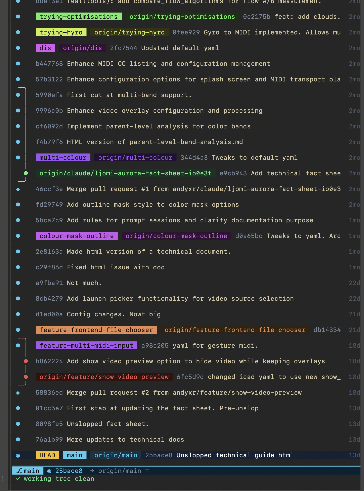
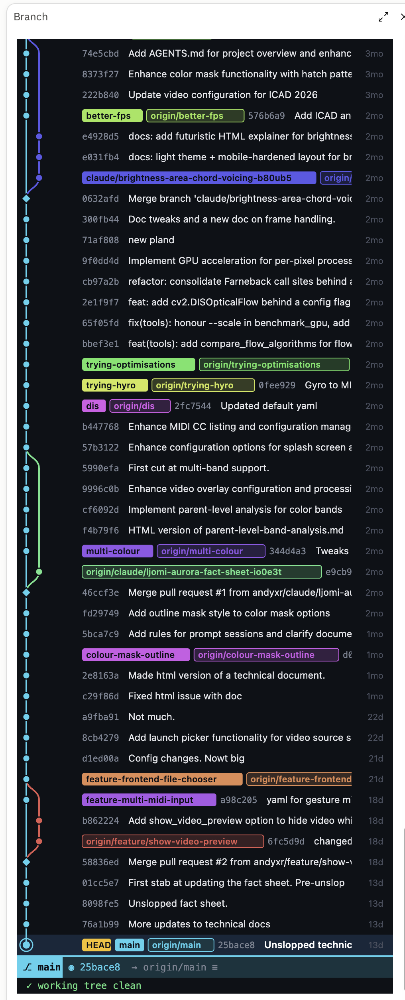
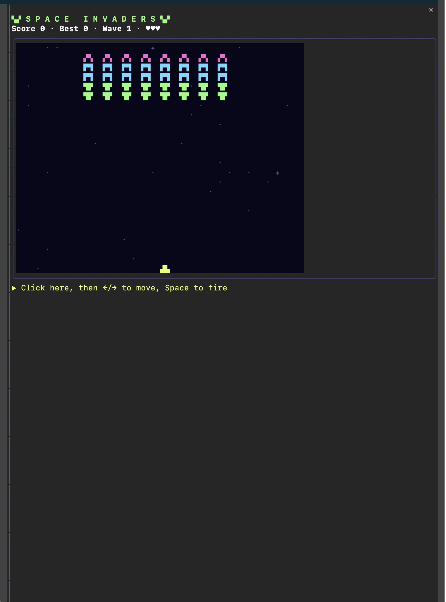
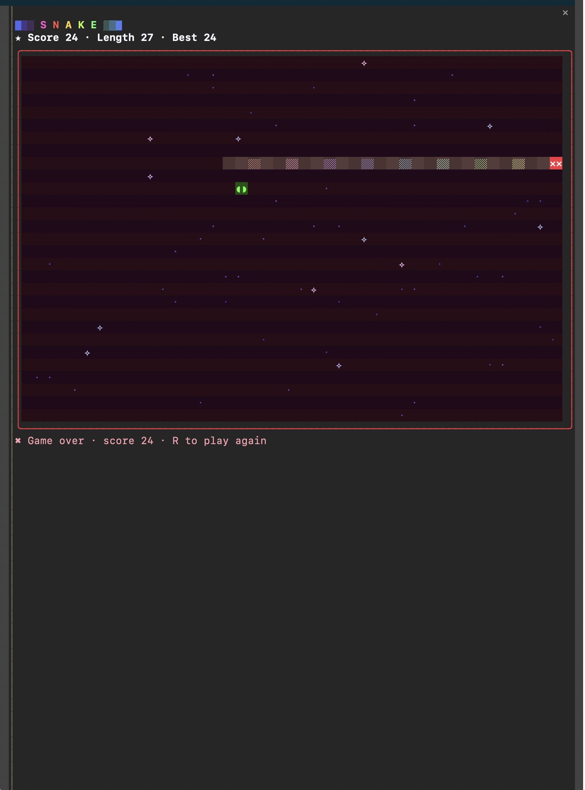
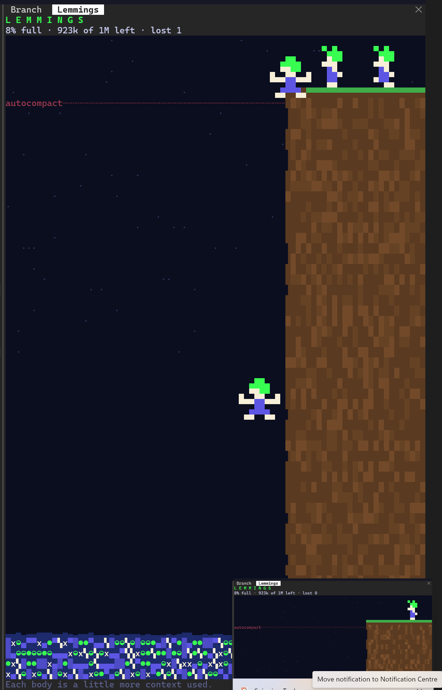

# claude-mods

A small marketplace of Claude Code mods by Andy Deighton.

| Mod | What it does |
| --- | --- |
| `branch-live` | Live, bottom-up git graph of the current branch and commit in a side pane: drawn in cells in the terminal, and as a scrollable SVG with hover details in the desktop app |
| `context-gauge` | Status line gauge: context tokens left and tokens until autocompact, plus a session timer above the prompt |
| `context-handoff` | Warns above the prompt when context gets long and offers a fresh session seeded with a hand-off (`/handyoff` shows it on demand) |
| `invaders` | `/invade` opens a game of Space Invaders in a side pane |
| `lemmings` | `/lemmings` opens a side pane where lemmings leap off a cliff and their bodies pile up as the context window fills |
| `snake` | `/snake` opens a game of Snake in a side pane |

## Screenshots

| `branch-live` in the terminal | `branch-live` in the desktop app |
| --- | --- |
|  |  |

| `invaders` | `snake` |
| --- | --- |
|  |  |

| `lemmings` |
| --- |
|  |

## Install

From a Claude Code prompt:

```
/plugin install branch-live --marketplace andyxr/claude-mods
```

Answer `y` to add the marketplace, then pick a scope.

From a shell:

```
claude plugin install branch-live --marketplace andyxr/claude-mods
```

In the Claude desktop app: click **+** next to the prompt box, then **Plugins**, **Add marketplace** with `andyxr/claude-mods`, then **Add plugin**. A mod installed from a shell at user scope also loads in the desktop app.

Swap `branch-live` for any mod name above. You don't need to clone anything: the install fetches the repo.

## Licence

MIT. See [LICENSE](LICENSE).
